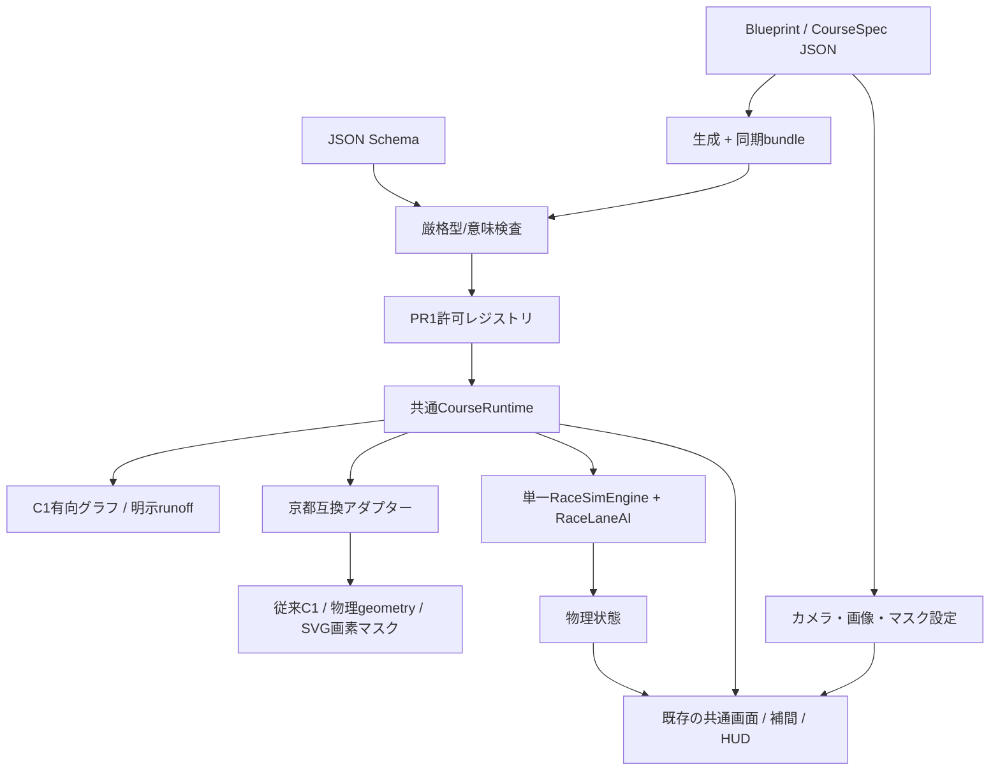

# Issue 75 / PR1: データ定義と共通走行API

互換比較基準: `c653c23fc7d80745dce08e32b890cb92a846e2eb`。
引継ぎ時PR HEAD: `f176feab634055ddd1833827e47a54fd8eb7784b`。
開始時main API観測: `52ab84c4ce9548419417e6e3a5af130352124083`、clone時origin/main: `a49dfdc070fdd08e825892f815a5796d2482154e`。並行更新を取り込んで上書きする操作はしない。PRブランチに追加コミットのみ。

## 既存コードとの照合と決定

既存のRaceSimEngine/RaceLaneAI、画像距離変換、枠色、HUD、補間を再利用。共通画面は既存 `race-clean-course-v1.html` 一つ。コース別HTML/エンジンを追加しない。

- TrackBlueprint: 独立した内外ラチの正規化座標、ノードと有向エッジ、エッジの物理長、芝/ダート、区間種別、幅、標高の根拠区分、画像・出典・許諾状態。
- RaceCourseSpec: blueprint参照、順序付きedgeIds、開始offset、START/GOAL、距離、区間・アンカー、最終直線、画像マスク、カメラ、明示runoff。周回は同じエッジIDの反復で表す。分岐で進路を推測せず、順序列を明示する。ゴールを途中に置く場合はエッジをゴールノードで分割し、runoffも明示する。
- JSON Schemaは追加属性を禁止し、ブラウザ/Node共通のバリデータが同じスキーマを使用。型・範囲・参照・距離和・接続・ラチ接続・順序・直線・レーン/幅・カメラ範囲を検査。compileでC1 Hermite補間、接続接線、0.25m以下間隔の安全領域・ラチ交差/退化を検査。これは図面の実測精度や実コース適合を証明するものではない。
- JSONが唯一の設定正本。`build-shared-course-v1.cjs` が同期起動用JSを生成し、CIが差分なしを検査。非同期ロードで旧画面の初期化順を壊さない。
- `RaceCourseRuntime` はposition/rails/tangent/section/grade/model/simulateを提供。graph-v1は架空検査走路で同じRaceSimEngineを使用。レーンは物理m、投影は画像px、Blueprintは0..1の座標で分離。型・距離・コース条件違いを拒否し、入力をdeep copy/freezeする。
- 京都は **互換アダプター**。既存60ノットC1、物理geometry、SVG画素マスクにそのまま委譲する。JSONの正規化トレースから再計算すると丸め差が生じ得るため、京都の旧トレースは移植の互換境界として残す。新グラフへ置換しない。
- engineに追加したのは明示的なgeometry/runoff/goal-camera設定注入のみ。指定なしの全従来経路は不変。既存の東京の速度特例等はPR2以降の検討対象で、今回変更しない。
- 余走の終了閾値32mとAPI上限125mを分ける。先頭馬は最後の馬より先に余走している。既存減速式 `14.2/.12*(1-exp(-.12*t))` の上限118.34m＋表示coast6mを125mで覆う。これは公式余走長ではない。
- 表示倍率、カメラ、画像の処理で物理状態を変更しない。物理は固定80msのまま。90表示とlegacy物理sixを分離する。

## 選択UIと利用許可の境界

コース・芝ダート・距離・2〜18頭・seed(1..999999)・1/2/4倍を選択する。出走馬モードの実17頭は保存データを保つため人数固定。seed/人数の変更は新しいレースとしてリセットする。距離・馬場の未検証候補はdisabled。

PR1の利用可能レジストリは京都芝2000内の既存互換経路だけに固定。JSONのstatus変更だけで別コースを開放できない。未知のcourse/surface/distance指定は拒否する。東京独立LABのロック・素材ローカル読込方式は変更しない。架空の支線/周回はtools内の構造試験であり、実コース追加ではない。

## 依存図

## 検査と残る判断

QA-PR1.md、QA-RESULTS-PR1.json、SOURCE-REGISTER.json、CI-EXISTING-GUARD.jsonを参照。
旧回帰検査の物理・位置・描画の条件は削除しない。ソース内定数の文字列検査は設定参照の検査へ移し、同じ数値をJSONでもassertする。固定SHA比較と実ブラウザの厳密一致を追加する。

人による画面全体の目視承認は未実施。SVG派生物の再配布許諾も未確定で、ソース権利台帳に記録。本番保護ガードには比較基準からのJSON不一致が残る。PRはDraft維持。マージ・Pages配信・STAGING移行・PR2着手はしない。
