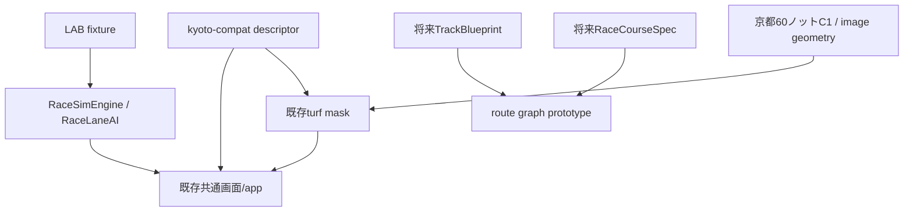

# Issue 75 / PR1: 共通基盤と京都互換移植

基準 main: c653c23fc7d80745dce08e32b890cb92a846e2eb。

既存コードとの照合で、RaceSimEngine/RaceLaneAIは共通だが、clean appの画像・距離・回り方向・カメラとturf maskの寸法・距離・アンカーが京都固定と確認。既存の汎用image geometryは再利用する。旧race-simulator系と東京独立LABを新しくコピーしない。

## 決定と改善

- 既存京都の60ノットC1補間・画素マスク・物理入力は保持し、共通設定を注入する互換アダプターから段階移行する。コース単位の新HTMLや走行エンジンは追加しない。
- TrackBlueprintの有向エッジをRaceCourseSpecのedgeIdsで順序選択。同じエッジの反復で周回、支線でポケット、エッジ属性で芝→ダートを表す。座標は0..1、距離はmで分離。
- 新route graphは構造検証用の線形投影プロトタイプ。京都のC1補間に置換しない。角度連続・ラチ交差・安全領域・標高・発走条件・明示runoffは今後の必須実装であり、現時点では新コースの走行許可に使わない。
- 90表示はlabAbilityScaleの明示opt-inで共通化。表示値と物理sixを分離し、既存の実出走馬入力は変更しない。
- 利用可能コースは検査済み互換アダプターの登録だけから作る。未知のcourse指定は拒否。東京のロックを解除しない。
- 既存台帳はA代表への集約がある。全設定・開催実績の網羅性を検証せず「全コース対応率」を算出しない。INVENTORY.mdは候補数としてのみ記録。

## 依存図

## 検証と残件

node tools/test-shared-course-v1.cjs は支線、遷移、直線、複数周回、不正定義、未対応IDを検査。
node tools/compare-shared-course-v1.cjs BASE_CHECKOUT は京都の架空18頭/実17頭×90/legacy×3seedの全状態、再現性、30,015座標を比較。

PR1完了前に必要: JSON schemaの厳密化、走路素材・出典・権利台帳、seed/人数UI、カメラ全設定注入、実ブラウザ390/1024×1/2/4比較、画素マスク安全性とゴール通過・全馬結果の検査。現時点でPR1完了または表示品質保証とはしない。

PR2は京都1400・東京2000・新潟直線の元素材、安全境界、距離アンカーを共通データへ登録。PR3は公式出典を照合した設定別在庫を作り、同じ検査を通した定義だけ追加。LAB→STAGING→本番は別の明示承認が必要。正式予想等のDATAには接続しない。
